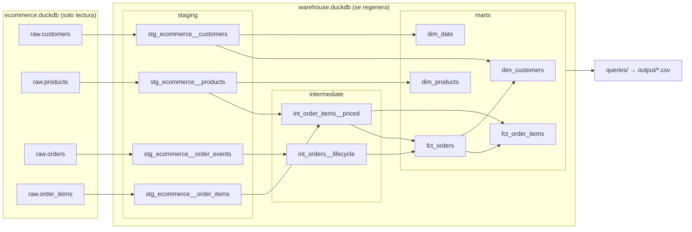
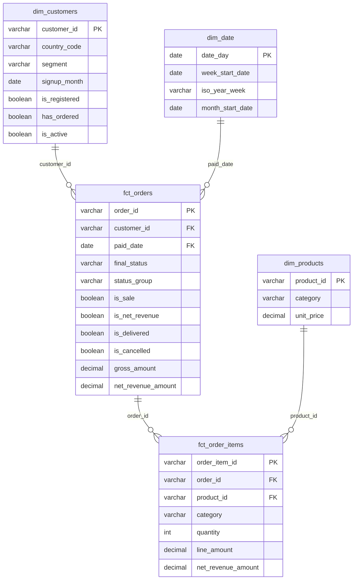
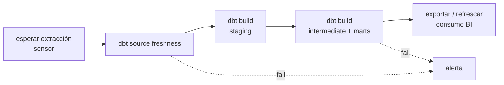

# Prueba técnica — Data Engineering

Modelo de datos de un e-commerce construido con **Python, SQL, dbt y DuckDB**, a partir de la extracción en bruto (`raw`) que se entrega en `data/ecommerce.duckdb`. El proceso es batch y se ejecuta con un único comando: limpia los datos, construye un modelo dimensional, valida la calidad con 74 tests y responde a las preguntas de negocio.

```bash
python run.py
```

## Índice

1. [Resultados](#resultados)
2. [Ejecución desde cero](#ejecución-desde-cero)
3. [Estructura del repositorio](#estructura-del-repositorio)
4. [Arquitectura y modelo de datos](#arquitectura-y-modelo-de-datos)
5. [Calidad de datos](#calidad-de-datos)
6. [Decisiones y supuestos](#decisiones-y-supuestos)
7. [Orquestación en producción](#orquestación-en-producción)
8. [Uso de IA](#uso-de-ia)
9. [Mejoras futuras](#mejoras-futuras)

---

## Resultados

Fecha de referencia: **2026-07-01 03:00**, el corte de la extracción (ver [decisión D1](#d1-fecha-de-referencia-el-corte-de-los-datos-no-la-fecha-de-ejecución)). Importes en USD.

| Necesidad | Consulta | Respuesta |
|---|---|---|
| **Clientes**: cuántos hay | [`01_clientes_resumen`](queries/01_clientes_resumen.sql) | **600** registrados, 402 han comprado alguna vez |
| **Clientes**: cuántos están activos | [`01_clientes_resumen`](queries/01_clientes_resumen.sql) | **371** activos (61,8 %) |
| **Clientes**: crecimiento mensual | [`02_clientes_crecimiento_mensual`](queries/02_clientes_crecimiento_mensual.sql) | De 26 altas (jul-2025) a 113 (jun-2026); la base crece entre un 21 % y un 27 % al mes desde octubre de 2025 |
| **Ventas**: por día | [`03_ventas_por_dia`](queries/03_ventas_por_dia.sql) | 3.557 ventas en 182 días; de ~10 diarias en enero a ~30 en junio |
| **Ventas**: por semana | [`04_ventas_por_semana`](queries/04_ventas_por_semana.sql) | De 88 (primera semana completa) a 205-221 en junio |
| **Ingresos**: totales | [`05_ingresos_totales`](queries/05_ingresos_totales.sql) | **3.667.812,14** de ingreso neto; ticket medio 1.074,34 |
| **Ingresos**: por categoría | [`06_ingresos_por_categoria`](queries/06_ingresos_por_categoria.sql) | Electronics 55,4 % · Home 18,0 % · Sports 16,6 % · Beauty 5,8 % · Books 4,2 % |
| **Órdenes**: entregadas y canceladas | [`07_ordenes_entregadas_canceladas`](queries/07_ordenes_entregadas_canceladas.sql) | **88,7 %** entregadas (3,7 % devueltas después) y **11,3 %** canceladas, sobre órdenes cerradas |

Puente de ingresos ([`05_ingresos_totales`](queries/05_ingresos_totales.sql)):

| Concepto | Órdenes | Importe |
|---|---:|---:|
| Órdenes pagadas | 3.687 | 4.009.921,54 |
| (-) Canceladas después del pago | -130 | -152.059,08 |
| **(=) Ventas** | **3.557** | **3.857.862,46** |
| (-) Devueltas | -143 | -190.050,32 |
| **(=) Ingreso neto** | **3.414** | **3.667.812,14** |

`run.py` imprime todas las tablas por consola y las exporta a `output/<consulta>.csv`.

---

## Ejecución desde cero

### Requisitos

- **Python 3.11 o superior** (probado con 3.14). Se puede descargar de [python.org](https://www.python.org/downloads/).
- **Git**.
- No hace falta instalar DuckDB ni dbt aparte: se instalan con `pip` dentro de un entorno virtual.

### Pasos

**1. Clonar el repositorio**

```bash
git clone https://github.com/Matias-Nardon/prueba-tecnica-data-engineering.git
cd prueba-tecnica-data-engineering
```

**2. Crear y activar un entorno virtual**

macOS / Linux:

```bash
python3 -m venv .venv
source .venv/bin/activate
```

Windows (PowerShell):

```powershell
python -m venv .venv
.venv\Scripts\Activate.ps1
```

**3. Instalar dependencias** (versiones fijadas en `requirements.txt`)

```bash
pip install -r requirements.txt
```

**4. Ejecutar el proceso**

```bash
python run.py
```

El proceso:

1. Lee `data/ecommerce.duckdb` **en solo lectura**: el origen nunca se modifica.
2. Construye el modelo en `data/warehouse.duckdb`, que se regenera en cada ejecución (`dbt build`: modelos y tests en orden de dependencias).
3. Ejecuta las consultas de `queries/`, las muestra por consola y las exporta a `output/`.

Si un modelo o un test falla, el proceso se detiene y termina con **código de salida 1**, para que un orquestador lo detecte.

### Opciones

```bash
python run.py --skip-queries     # solo construir el modelo
python run.py --select staging   # construir una parte del modelo (selector de dbt)
```

### Explorar el modelo

El warehouse se puede abrir con cualquier cliente de DuckDB (CLI, DBeaver, [duckui](https://duckui.com)…). Las tablas de negocio están en el schema `marts`.

Documentación y linaje generados por dbt (desde la carpeta `transform/`):

```bash
cd transform
dbt docs generate --profiles-dir .
dbt docs serve --profiles-dir .
```

Para recalcular las métricas de clientes a otra fecha de referencia o con otra ventana de actividad:

```bash
cd transform
dbt build --profiles-dir . --vars "{as_of_date: '2026-03-31', active_customer_window_days: 60}"
```

---

## Estructura del repositorio

```
.
├── data/
│   └── ecommerce.duckdb          # origen tal como llega (schema raw); no se modifica
├── analysis/
│   └── 01_perfilado_raw.sql      # fase 0: exploración de raw con los hallazgos anotados
├── transform/                    # proyecto dbt
│   ├── dbt_project.yml           # configuración, materializaciones y variables
│   ├── profiles.yml              # conexión: escribe en warehouse.duckdb, adjunta raw en solo lectura
│   ├── macros/                   # nombres de schema y fecha de referencia
│   ├── models/
│   │   ├── staging/              # limpieza y deduplicación, 1 modelo por tabla de raw
│   │   ├── intermediate/         # ciclo de vida de la orden y valorización de líneas
│   │   └── marts/                # modelo dimensional para negocio
│   └── tests/                    # tests singulares y test genérico is_positive
├── queries/                      # una consulta por pregunta de negocio
├── run.py                        # punto de entrada único
└── requirements.txt              # dependencias con versión fijada
```

Generados en cada ejecución y excluidos de git: `data/warehouse.duckdb`, `output/`, `transform/target/` y `transform/logs/`.

---

## Arquitectura y modelo de datos

### Flujo



### Capas

| Capa | Responsabilidad | Materialización |
|---|---|---|
| **staging** | Una versión limpia de cada tabla de raw: deduplicación de reentregas, normalización de textos y claves sustitutas. Sin cruces ni lógica de negocio. Es la única capa que lee de raw. | Tabla |
| **intermediate** | Pasos de cálculo reutilizables: del log de eventos a una fila por orden con sus hitos; importe de cada línea. | Vista |
| **marts** | Modelo dimensional (estrella) con las definiciones de negocio aplicadas como columnas. | Tabla |

### Modelo dimensional (marts)



| Tabla | Granularidad | Responde a |
|---|---|---|
| `dim_customers` | 1 fila por cliente | Total, activos y crecimiento mensual |
| `dim_products` | 1 fila por producto | Categoría |
| `dim_date` | 1 fila por día | Agregación por día, semana ISO y mes, sin huecos |
| `fct_orders` | 1 fila por orden | Ventas, ingresos, entregadas y canceladas |
| `fct_order_items` | 1 fila por línea de orden | Ingresos por categoría |

Las definiciones de negocio viven **en un solo sitio**, como columnas de `fct_orders` (`is_sale`, `is_net_revenue`, `is_delivered`, `is_cancelled`). Las consultas filtran por ellas en lugar de repetir la lógica, así que cambiar una definición es cambiar una línea.

---

## Calidad de datos

### Hallazgos del perfilado

Antes de modelar se perfiló raw ([`analysis/01_perfilado_raw.sql`](analysis/01_perfilado_raw.sql)). Problemas encontrados y cómo se tratan:

| Hallazgo | Volumen | Tratamiento |
|---|---|---|
| Eventos de orden reentregados (mismo `order_id`, `status` y `event_at` con distinto `_ingested_at`) | 443 de 15.608 | Deduplicación en staging, conservando la primera ingesta |
| Líneas de orden reentregadas (misma `order_id` y `line_number`, mismo contenido) | 205 de 7.820 | Deduplicación en staging, conservando la primera ingesta |
| Órdenes sin evento `created` (empiezan en `paid`) | 5 | `created_at` = primer evento; marcadas con `is_missing_created_event` |
| Órdenes sin líneas | 5 | Importe 0; marcadas con `is_missing_items` |
| Precio sin histórico y ausente de `order_items` | 26 productos modificados | Se usa el precio de lista actual ([D7](#d7-importe--cantidad--precio-de-lista-actual)) |
| Histórico de órdenes más corto que el de clientes | Clientes desde jul-2025, órdenes desde ene-2026 | El crecimiento se mide por alta, no por primera compra ([D4](#d4-crecimiento-de-clientes-por-mes-de-alta)) |

Comprobado y sin incidencias: sin nulos, sin huérfanos entre tablas, sin eventos fuera de orden lógico (por ejemplo, entregas antes del pago) y sin órdenes anteriores al alta de su cliente.

### Tests (74, se ejecutan en cada `dbt build`)

| Tipo | Qué garantiza | Ejemplos |
|---|---|---|
| `unique` + `not_null` | Cada clave identifica una sola fila | `order_event_id`, `order_id`, `customer_id` |
| `accepted_values` | Solo valores conocidos | estados de la orden, países, categorías, moneda = USD |
| `relationships` | Sin huérfanos | líneas → productos, órdenes → clientes, `paid_date` → calendario |
| `is_positive` (genérico propio) | Valores con sentido de negocio | `quantity`, `unit_price`, `line_amount` |
| Singular | Reglas que cruzan modelos | el ingreso cuadra entre `fct_orders` y `fct_order_items`; ninguna orden de raw se pierde |

Algunos tests son alarmas para el futuro. Por ejemplo, `currency = USD`: hoy todo el catálogo está en dólares y se suman importes sin convertir. Si llega otra moneda, el proceso falla **antes** de publicar un ingreso que mezcle monedas.

---

## Decisiones y supuestos

### Definiciones de negocio

#### D1. Fecha de referencia: el corte de los datos, no la fecha de ejecución

Las métricas relativas al tiempo, como "activo en los últimos 30 días", se calculan respecto a `max(_extracted_at)` = **2026-07-01 03:00**. Con `now()` el resultado cambiaría cada día sin que cambiaran los datos y "activos" daría 0. Así el proceso es **reproducible**. Se puede fijar otra fecha con la variable `as_of_date`.

#### D2. Cliente = registrado en la plataforma

Total de clientes = todos los registrados a la fecha de referencia (600). Se informa aparte cuántos han comprado alguna vez (402).

#### D3. Cliente activo = al menos una orden no cancelada en los últimos 30 días

La ventana sale de los datos: la mediana entre compras de un mismo cliente es de **7 días** (p80 = 17). Con 90 días, 398 de los 399 compradores con alguna orden no cancelada saldrían activos y la métrica no discriminaría. La ventana es configurable (`active_customer_window_days`).

#### D4. Crecimiento de clientes por mes de alta

Se mide por `created_at` del cliente, con acumulado y porcentaje de crecimiento sobre la base del mes anterior. No se usa el mes de la primera compra porque el histórico de órdenes empieza en enero de 2026 y generaría un pico falso ese mes. Solo se muestran meses completos.

#### D5. Venta = orden pagada y no cancelada después, fechada por el pago

Una orden creada es intención de compra: 304 órdenes se cancelan antes de pagarse. Usar el pago alinea ventas e ingresos sobre la misma población. Consecuencia que conviene saber: si una orden se cancela días después de pagarse, el recuento de ventas del día del pago baja.

#### D6. Ingreso neto = ventas no devueltas

KPI principal: ingreso de las ventas que no se han devuelto (3,67 M). Se publica también el puente desde lo pagado para explicar las diferencias. Una devolución resta el importe completo de la orden, porque la fuente no tiene devoluciones parciales.

#### D7. Importe = cantidad × precio de lista actual

`order_items` no guarda el precio de la venta y `products` no tiene histórico: 26 productos se modificaron después de crearse. Es la única aproximación posible, pero **puede no coincidir con lo que se cobró**. Es la principal limitación del modelo (ver [mejoras](#mejoras-futuras)).

#### D8. Entregadas y canceladas: estado final, sobre órdenes cerradas

- Cada orden cuenta por su **último estado**.
- Denominador: órdenes **cerradas** (delivered, returned, cancelled). Las 169 en curso todavía no han podido entregarse (la más antigua tiene 8 días) y, si se incluyeran, bajarían la tasa de forma artificial. La consulta muestra también el porcentaje sobre el total.
- Una orden **devuelta cuenta como entregada**, porque llegó al cliente, y se desglosa aparte.
- Las cancelaciones se desglosan en antes del pago (304) y después del pago (130, que implican reembolso).

### Supuestos sobre los datos

- **Zona horaria:** los timestamps no la indican y se tratan como UTC. Las fechas por país podrían desplazarse un día.
- **Semana ISO** (de lunes a domingo). Las semanas y días incompletos de los extremos se marcan.
- **Moneda:** todo el catálogo está en USD; un test lo vigila.
- **Reentregas:** la fuente entrega *at-least-once*. Dos registros con el mismo contenido de negocio son el mismo evento.
- **Snapshots:** `customers` y `products` son extracciones completas. Si se acumularan varias, staging se queda con la más reciente de cada id.

### Decisiones técnicas

| Decisión | Motivo |
|---|---|
| **dbt** sobre DuckDB | Linaje, tests y documentación integrados; el SQL queda modular y revisable. |
| **dbt Core v1** (1.12) y no v2 | El adapter dbt-duckdb es maduro en v1. |
| Warehouse en un **archivo DuckDB aparte**, raw **adjunto en solo lectura** | El origen es inmutable y el proceso es idempotente: borrar el warehouse y volver a ejecutar da el mismo resultado. |
| **Reconstrucción completa** en cada ejecución | Unas 15.000 filas se procesan en unos 2 segundos. En producción se pasaría a incremental (ver [orquestación](#orquestación-en-producción)). |
| Staging y marts como **tabla**, intermediate como **vista** | El warehouse queda autocontenido para cualquier cliente que lo abra; intermediate no lo consume nadie fuera del modelo. |
| **Sin paquetes externos** de dbt (`dbt_utils`) | La instalación es solo `pip install`; el único test que hacía falta (`is_positive`) es propio. |
| `profiles.yml` **dentro del repositorio** | No depende de la configuración de `~/.dbt` de cada máquina; no contiene credenciales. |
| Punto de entrada en **Python** (`run.py`) con la API de dbt | Un único comando, códigos de salida claros y fácil de envolver en un orquestador. |
| Las dimensiones **no se recortan** por la fecha de referencia | Con una `as_of_date` pasada, filtrar `dim_customers` dejaba 673 órdenes huérfanas y recortar `dim_date` dejaba 2.320 sin fecha; los detectaron los tests de relaciones. `dim_customers` marca `is_registered` y el calendario llega hasta el último dato; las consultas acotan el rango. |

---

## Orquestación en producción

No está implementada (el enunciado no lo pide), pero así la plantearía con **Airflow** (por ejemplo, Amazon MWAA).

### DAG diario



| Aspecto | Propuesta |
|---|---|
| **Programación** | Diaria, después de la extracción (que hoy termina a las 03:00), por ejemplo `0 4 * * *`. Mejor aún, disparada por la llegada de los datos (sensor o *dataset* de Airflow) que por hora fija. |
| **Dependencia del origen** | Un sensor espera a que la extracción del día haya aterrizado, y `dbt source freshness` (sobre `_extracted_at` / `_ingested_at`) para el DAG si los datos no están frescos, en lugar de publicar cifras viejas. |
| **Granularidad de las tareas** | Una tarea por capa con `dbt build --select staging`, etc. Con [astronomer-cosmos](https://github.com/astronomer/astronomer-cosmos), cada modelo de dbt se convierte en una tarea de Airflow, para ver y reintentar fallos por modelo. |
| **Fecha de referencia** | `as_of_date` se pasa desde el contexto de Airflow (`{{ data_interval_end }}`). Así cada ejecución es reproducible y los **backfills** recalculan correctamente días pasados. |
| **Carga incremental** | `stg_ecommerce__order_events` y `stg_ecommerce__order_items` pasarían a `materialized='incremental'` filtrando por `_ingested_at` con una **ventana de solape** (por ejemplo, 3 días) para recoger reentregas y llegadas tardías. La deduplicación por clave hace que reprocesar sea seguro (idempotente, con `unique_key`). Customers y products, al ser snapshots, se pueden recargar enteros o historificar con `dbt snapshot` (SCD tipo 2), lo que además resolvería el histórico de precios. |
| **Calidad** | Los tests forman parte de `dbt build`: un test fallido corta la cadena antes de publicar. Los tests de alarma (moneda, valores aceptados) se pueden marcar como `severity: warn` si se prefiere avisar sin bloquear. |
| **Reintentos y alertas** | `retries=2` con espera exponencial para fallos transitorios; notificación (correo, Slack o Teams) en `on_failure_callback`; SLA sobre la hora de disponibilidad del dato. |
| **Entornos y despliegue** | Proyecto en git con CI (GitHub Actions o GitLab CI) que ejecuta `dbt build` sobre una muestra en cada merge request; despliegue a DEV → PRE → PRO. En producción el warehouse sería un motor compartido (Snowflake, BigQuery, MotherDuck…) cambiando solo el `profiles.yml`. |
| **Observabilidad** | Guardar los artefactos de dbt (`run_results.json`, `manifest.json`) de cada ejecución para medir duración, filas y fallos a lo largo del tiempo. |

---

## Uso de IA

Se usó **Claude Code** (Anthropic) como asistente durante todo el trabajo. Los commits en los que intervino lo indican con `Co-Authored-By`.

| Para qué | Detalle |
|---|---|
| Perfilado | Redactar y ejecutar las consultas de exploración de raw y resumir los hallazgos. |
| Propuesta de definiciones | Cuantificar con los datos las alternativas de cada definición de negocio (ventanas de actividad, denominadores, variantes de ingreso). **La elección final la tomó el autor.** |
| Código | Generar los modelos dbt, tests, consultas y `run.py` a partir de las decisiones acordadas. |
| Verificación | Ejecutar el pipeline y contrastar cada cifra del modelo con el cálculo directo sobre raw. |
| Documentación | Redactar este README. |

Todo el código se ejecutó y se revisó. Las cifras del modelo coinciden con las calculadas de forma independiente sobre raw durante el perfilado.

---

## Mejoras futuras

- **Precio de la venta:** pedir a la fuente el precio unitario en `order_items`, o historificar `products` con `dbt snapshot`, para valorar cada línea con el precio vigente en la fecha de pago.
- **Carga incremental** de los modelos de eventos (ver [orquestación](#orquestación-en-producción)).
- **Zona horaria por país** para fechar las ventas en hora local.
- **Contratos de modelo** de dbt (`contract: enforced`) en marts para garantizar tipos y columnas a los consumidores.
- **Capa de consumo** (Power BI, Metabase, Evidence…) sobre `marts`, con las definiciones documentadas en un catálogo.
